# 🎮 LAN House & Arena Pixel Art — Simulador de Gestão em POO

<p align="center">
  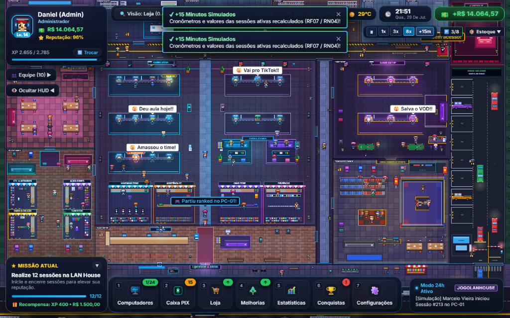
</p>

<p align="center">
  
  
  
  
  
  
</p>

Simulador completo de **LAN House & Arena Gamer** em **Pixel Art Dark-Neon**, desenvolvido com **React + TypeScript + HTML5 Canvas 2D** para demonstrar na prática a aplicação de **Programação Orientada a Objetos (POO)**, **Padrões de Projeto** e **Regras de Negócio Formais (`RF01–RF12`, `RN01–RN10`, `RNF02–RNF06`)** em um mundo vivo de **96×64 tiles** com clientes autônomos, tráfego urbano e estacionamento automatizado.

---

## 📑 Sumário

- [Visão Geral do Mundo & Simulação](#-visão-geral-do-mundo--simulação)
- [Arquitetura em 3 Camadas](#-arquitetura-em-3-camadas)
- [Os 4 Pilares da POO Aplicados no Código](#-os-4-pilares-da-poo-aplicados-no-código)
- [Diagramas UML Formais](#-diagramas-uml-formais)
- [Mapeamento de Requisitos Acadêmicos](#-mapeamento-de-requisitos-acadêmicos)
- [Galeria de Telas & Evidências Reais](#-galeria-de-telas--evidências-reais)
- [Atalhos de Teclado e Controles](#-atalhos-de-teclado-e-controles)
- [Como Executar o Projeto](#-como-executar-o-projeto)
- [Integração Opcional com Backend Java (JDK 17)](#-integração-opcional-com-backend-java-jdk-17)
- [Estrutura do Repositório](#-estrutura-do-repositório)
- [Material de Apresentação](#-material-de-apresentação)

---

## 🌍 Visão Geral do Mundo & Simulação

- **Mapa 96×64 Tiles (`3072 × 2048 px`):** Grade de colisão em meio-tile (`192 × 128` células de `16 px`), câmera com zoom suave (`0.5×` a `2.0×`) e botão retrátil **`Ocultar HUD [H]`** para inspeção panorâmica do cenário.
- **8 Setores Integrados:** `RUA`, `RECEPCAO`, `AREA_COMUM`, `AREA_VIP`, `BOMBONIERE`, `MANUTENCAO`, `ESCRITORIO` e `ESTACIONAMENTO`.
- **Paridade 24/24 de Estações:** O motor bloqueia cadastros acima de `MAX_ESTACOES_MAPA = 24` (**18 estações comuns + 6 estações VIP**), sincronizando exatamente as bancadas desenhadas no mapa com o painel de gestão e telemetria.
- **Tráfego Urbano & Estacionamento Automatizado (`src/world/parking.ts` & `traffic.ts`):** Veículos da avenida entram no pátio de **8 vagas numeradas (`V01–V08`)** com cancelas articuladas de entrada/saída, sensores anti-colisão (`faixaVerticalOcupada`, `zonaManobraOcupada`), acionamento manual e cobrança integrada ao caixa via callback `onTicketPago`.
- **Controle Temporal & Áudio:** Aceleração em `1x`, `3x`, `8x` e botão **`+15m`** para validar cronômetros e faturamento (`RF07` / `RN04`), além de efeitos sonoros sintetizados em `src/audio/soundEffects.ts`.

<p align="center">
  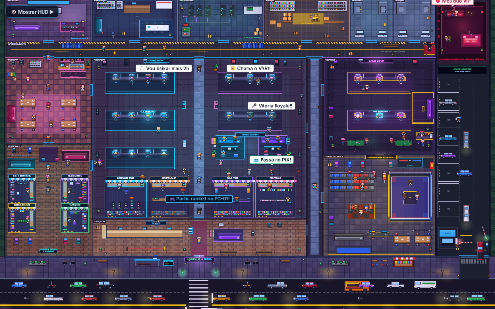
  <br />
  <em>Modo panorâmico ativado pelo atalho <code>[H]</code> exibindo os salões gamer, lojas, lounges e pátio automatizado.</em>
</p>

---

## 🧱 Arquitetura em 3 Camadas

O projeto separa responsabilidades de domínio, simulação espacial e interface reativa para garantir testabilidade e ausência de regras de negócio espalhadas nos componentes visuais:

| Camada | Diretório / Módulos | Responsabilidades |
| :--- | :--- | :--- |
| **1. Domínio & Motor POO** | `src/domain/LanHouseEngine.ts`<br>`src/domain/types.ts`<br>`src/domain/WaypointGraph.ts` | Hierarquia abstrata de cargos, estratégias polimórficas de pagamento, Singleton encapsulado (`LanHouseStore`), exceções `RegraNegocioError`, trilha de auditoria (`LogAuditoria`), hash PBKDF2 e persistência `RNF06`. |
| **2. Mundo, Física & Grafo** | `src/world/constants.ts`, `layout.ts`<br>`src/world/collision.ts`, `graph.ts`<br>`src/world/parking.ts`, `traffic.ts`<br>`src/world/decor.ts`, `detalhes.ts`, `mobiliario.ts` | Dimensões `96×64`, grafo de navegação (`NoGrafo`, `construirGrafo()`), detecção de colisão, simulação viária da avenida e Máquina de Estados Finitos de 9 fases do estacionamento. |
| **3. Interface React & Canvas 2D** | `src/App.tsx`, `HudOverlay.tsx`, `LanHouseCanvas.tsx`<br>`src/components/*Renderer.ts`, `RpgPixelSpriteEngine.ts`<br>`src/components/modals/*` (10 modais) | Renderização Pixel Art em camadas com profundidade (`LanHouseDepth.ts`), sprites animados, HUD reativo assinado via Observer (`subscribe()`) e modais dedicados por módulo. |

---

## 🧩 Os 4 Pilares da POO Aplicados no Código

### 1. Abstração (`PerfilCargoPOO` & `ProcessadorFormaPagamento`)
Duas classes abstratas em `src/domain/LanHouseEngine.ts` obrigam contratos padronizados sem expor detalhes internos à UI:
- `PerfilCargoPOO`: declara `cargo`, `nomeExibicao`, `salarioBase` e o método abstrato `obterPermissoes(): Permissao[]`, fornecendo `possuiPermissao(p)`.
- `ProcessadorFormaPagamento`: declara `forma`, `descricao` e o método abstrato `calcularTotal(valorBruto)`.

### 2. Encapsulamento (`LanHouseStore`)
Todo o estado crítico (`caixaSaldo`, `sessoes`, `pagamentos`, `computadores`, `funcionarios`, `produtos`, `logs`, `estacionamento`) permanece privado (`private state: EstadoCompletoLanHouse`) e só sofre mutações por métodos públicos validados que:
- Verificam permissões RBAC via `exigirPermissao(permissao, regraCodigo)`.
- Lançam `RegraNegocioError` em violações de domínio (`RF`, `RN`, `RNF`).
- Congelam o valor/hora na abertura da sessão (`tarifaPorHoraCongelada`).
- Sanitizam métricas na carga (`sanitizarEstadoParaMetricasReais()`), impedindo PCs órfãos acima de `MAX_ESTACOES_MAPA = 24`.

### 3. Herança & Factory (`FABRICA_CARGOS`)
O método `contratarFuncionario()` consulta o registro `FABRICA_CARGOS` para instanciar o perfil de acesso e salário sem duplicação de código na UI:

| Subclasse (`extends PerfilCargoPOO`) | Código | Salário Base | Permissões Encapsuladas (`obterPermissoes()`) |
| :--- | :--- | :---: | :--- |
| `CargoAdministrador` | `ADMINISTRADOR` | `R$ 4.200,00` | Acesso total (11 permissões, único autorizado a `ESTORNAR_PAGAMENTO`) |
| `CargoDesenvolvedor` | `DESENVOLVEDOR` | `R$ 3.500,00` | `CONSULTAR_HISTORICO` |
| `CargoSuporteTecnico` | `SUPORTE_TECNICO` | `R$ 2.650,00` | `MANUTENCAO_COMPUTADOR`, `CONSULTAR_HISTORICO` |
| `CargoGuardaPatio` | `GUARDA_PATIO` | `R$ 2.200,00` | `MANUTENCAO_COMPUTADOR`, `CONSULTAR_HISTORICO` |
| `CargoRecepcionista` | `RECEPCIONISTA` | `R$ 2.150,00` | `GERENCIAR_CLIENTE`, `OPERAR_SESSAO`, `REGISTRAR_PAGAMENTO`, `CONSULTAR_HISTORICO` |
| `CargoPorteiroEstacionamento` | `PORTEIRO_ESTACIONAMENTO` | `R$ 2.050,00` | `OPERAR_SESSAO`, `REGISTRAR_PAGAMENTO`, `CONSULTAR_HISTORICO` |
| `CargoLimpeza` | `LIMPEZA` | `R$ 1.850,00` | `MANUTENCAO_COMPUTADOR` |

### 4. Polimorfismo (`PROCESSADORES_PAGAMENTO`)
Ao encerrar e liquidar uma sessão em `ClientsPaymentsModal.tsx`, o motor despacha `PROCESSADORES_PAGAMENTO[forma].calcularTotal(valorBruto)` sem cadeias de `if/else` na tela:
- **`PagamentoPix`:** aplica automaticamente **5% de desconto** (`R$ 48,00` → `-R$ 2,40` → `R$ 45,60`).
- **`PagamentoDinheiro`**, **`PagamentoCartaoDebito`**, **`PagamentoCartaoCredito`:** liquidam o valor integral (`desconto = 0`).

### Padrões Complementares
- **Observer (`subscribe()` / `salvarEEmitir()`):** `HudOverlay` e os modais assinam a `LanHouseStore` e atualizam instantaneamente a cada mutação persistida.
- **Composição de Objetos:** `Sessao` compõe `ItemConsumacao[]`, onde cada item referencia um `Produto` (com reposição a `45%` do preço de venda e flag idempotente `estoqueDevolvido` em caso de estorno).
- **Máquina de Estados Finitos (`FaseCarroEstac`):** controla o ciclo completo de 9 fases de cada veículo no pátio em `src/world/parking.ts`.

---

## 📐 Diagramas UML Formais

### Diagrama de Classes — Domínio (`LanHouseEngine.ts` & `types.ts`)

```mermaid
classDiagram
    class PerfilCargoPOO {
        <<abstract>>
        +readonly cargo
        +readonly nomeExibicao
        +readonly salarioBase
        +obterPermissoes()* Permissao[]
        +possuiPermissao(p) boolean
    }

    class CargoAdministrador { +obterPermissoes() Permissao[] }
    class CargoDesenvolvedor { +obterPermissoes() Permissao[] }
    class CargoSuporteTecnico { +obterPermissoes() Permissao[] }
    class CargoRecepcionista { +obterPermissoes() Permissao[] }
    class CargoLimpeza { +obterPermissoes() Permissao[] }
    class CargoPorteiroEstacionamento { +obterPermissoes() Permissao[] }
    class CargoGuardaPatio { +obterPermissoes() Permissao[] }

    PerfilCargoPOO <|-- CargoAdministrador
    PerfilCargoPOO <|-- CargoDesenvolvedor
    PerfilCargoPOO <|-- CargoSuporteTecnico
    PerfilCargoPOO <|-- CargoRecepcionista
    PerfilCargoPOO <|-- CargoLimpeza
    PerfilCargoPOO <|-- CargoPorteiroEstacionamento
    PerfilCargoPOO <|-- CargoGuardaPatio

    class ProcessadorFormaPagamento {
        <<abstract>>
        +calcularTotal(valorBruto)*
    }
    class PagamentoPix { +calcularTotal(valorBruto) }
    class PagamentoDinheiro { +calcularTotal(valorBruto) }
    class PagamentoCartaoDebito { +calcularTotal(valorBruto) }
    class PagamentoCartaoCredito { +calcularTotal(valorBruto) }

    ProcessadorFormaPagamento <|-- PagamentoPix
    ProcessadorFormaPagamento <|-- PagamentoDinheiro
    ProcessadorFormaPagamento <|-- PagamentoCartaoDebito
    ProcessadorFormaPagamento <|-- PagamentoCartaoCredito

    class LanHouseStore {
        -state: EstadoCompletoLanHouse
        -listeners: Set
        +readonly MAX_ESTACOES_MAPA = 24
        +subscribe(listener)
        -salvarEEmitir()
        -exigirPermissao(permissao)
        -registrarLog(categoria, acao)
        +autenticar(login, senha)
        +contratarFuncionario()
        +cadastrarComputador()
        +iniciarSessao()
        +adicionarConsumoSessao()
        -recalcularSessao(sessao)
        +encerrarSessao()
        +registrarPagamento()
        +confirmarPagamentoPendente()
        +estornarPagamento()
        +reporEstoqueProduto()
        +evoluirMelhoriaEstabelecimento()
        +registrarTicketEstacionamento()
        +alterarTarifaEstacionamento()
        +gerarRelatorioFinanceiro()
        +obterConquistas()
    }

    LanHouseStore ..> PerfilCargoPOO : consulta FABRICA_CARGOS
    LanHouseStore ..> ProcessadorFormaPagamento : consulta PROCESSADORES_PAGAMENTO
    LanHouseStore *-- "1..24" Computador : gerencia
    LanHouseStore *-- "*" Sessao : registra
    LanHouseStore *-- "*" Pagamento : liquida
    LanHouseStore *-- "*" Produto : estoca
    LanHouseStore *-- "*" Funcionario : emprega
    LanHouseStore *-- "*" LogAuditoria : audita
    Sessao *-- "*" ItemConsumacao : compoe
    ItemConsumacao --> Produto : referencia
```

### Máquina de Estados Finitos — Estacionamento (`src/world/parking.ts`)

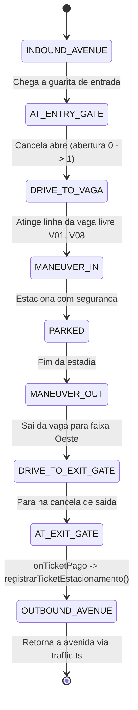

---

## 📋 Mapeamento de Requisitos Acadêmicos

| Código | Requisito / Regra de Negócio | Implementação no Domínio (`LanHouseStore`) | Onde Testar na Interface |
| :--- | :--- | :--- | :--- |
| **RF01 / RF02** | Cadastro e busca de clientes (`nome`, `telefone`, `identificador`) | Cadastro validado e busca indexada | Dock `[2]` → **Clientes & Caixa** |
| **RF03 / RF04** | Cadastro de PCs (`preço/hora`, limite `24/24`) e controle de status (`LIVRE`, `OCUPADO`, `MANUTENCAO`) | `cadastrarComputador()` + trava `MAX_ESTACOES_MAPA = 24` | Clique direto no PC no mapa ou Dock `[1]` → **Computadores** |
| **RF05 / RF06 / RF07** | Iniciar/encerrar sessão, cálculo por tempo e congelamento de tarifa | `iniciarSessao()`, `encerrarSessao()`, `tarifaPorHoraCongelada` | Dock `[1]` → **Computadores** + botão **`+15m`** no relógio |
| **RF08 / Polimorfismo** | Pagamento via `PIX` (`5% OFF`), `DINHEIRO`, `DEBITO` ou `CREDITO` | `registrarPagamento()` via `PROCESSADORES_PAGAMENTO` | Dock `[2]` → **Clientes & Caixa** → **Registrar Pagamento** |
| **RF09** | Histórico completo de sessões por cliente | Consulta vinculada `Sessao` ↔ `Cliente` | Dock `[2]` → **Clientes & Caixa** (selecionar cliente) |
| **RF10 / RN09** | Relatório financeiro por período somando apenas pagamentos `CONFIRMADO` | `gerarRelatorioFinanceiro()`, `ticketMedioGastoReal` | Dock `[6]` → **Estatísticas & Analytics** |
| **RF11 / Herança** | Gestão de funcionários e turnos usando 7 subclasses concretas | `contratarFuncionario()` + `FABRICA_CARGOS` | Dock `[5]` → **Equipe** + sub-aba **Hierarquia & Permissões (POO)** |
| **RF12 / RNF02 / RN10** | Autenticação com hash PBKDF2, RBAC por permissão e estorno restrito ao Admin | `autenticar()`, `gerarHashSenha()`, `exigirPermissao()`, `estornarPagamento()` | Card superior esquerdo → **`Trocar`** (senha inicial: `Lan@House2026`) |
| **RN01 / RN05 / RN07 / RN08 / RNF03** | Bloqueio de PC ocupado/em manutenção, cliente em 2 sessões, consumo fora de sessão ativa, estoque insuficiente e pagamento duplicado | Exceções `RegraNegocioError` com toast visual + registro em `LogAuditoria` | Validado automaticamente ao tentar operações inválidas nos modais |
| **RNF06** | Persistência após fechar o sistema + exportação/importação | `salvarEEmitir()` (`localStorage`) + Backup `.JSON` sanitizado | Dock `[8]` → **Configurações → Dados e Salv.** |

---

## 🖼️ Galeria de Telas & Evidências Reais

Todas as telas abaixo foram capturadas diretamente da simulação executada ao vivo em `localhost:5173` (salvas em [`docs/screenshots/`](./docs/screenshots)):

<details>
<summary><strong>Abrir galeria completa com todas as 11 telas dos módulos (Computadores, Caixa PIX, Loja, Estacionamento, POO, Analytics...)</strong></summary>

<br />

| Módulo / Aba | Captura Real da Simulação | Destaques Observados |
| :--- | :---: | :--- |
| **Computadores & Telemetria** | 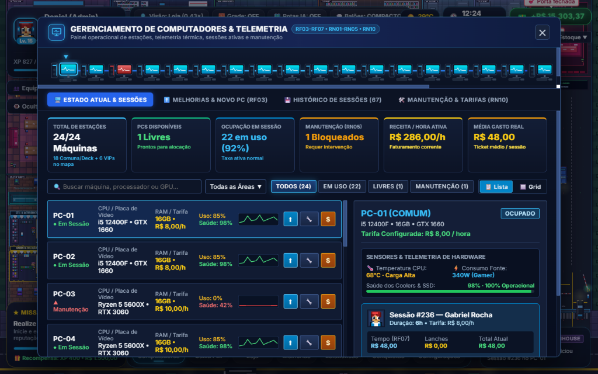 | `24/24` estações (`22 em uso / 92%`), `PC-03` em manutenção, `R$ 286,00/h`, Sessão `#236` (`68°C / 340W`). |
| **Clientes & Caixa PIX** | 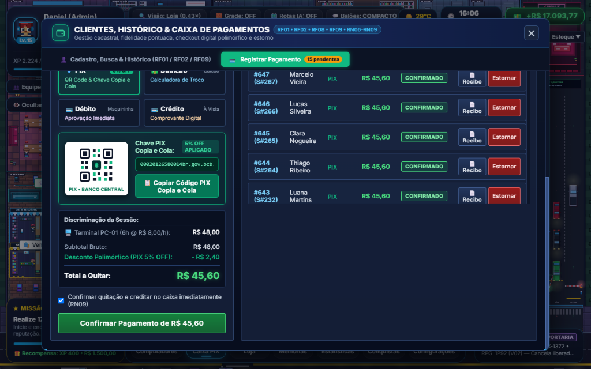 | Polimorfismo PIX: `6h @ R$ 8,00/h = R$ 48,00` com `5% OFF (-R$ 2,40)` → **`R$ 45,60`** (`#647 CONFIRMADO`). |
| **Loja & Bomboniere** | 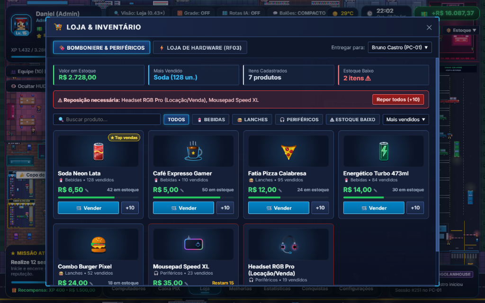 | Composição `Sessao → ItemConsumacao → Produto`, estoque `R$ 2.728,00`, entrega direta ao `PC-01`. |
| **Melhorias & Serviços** | 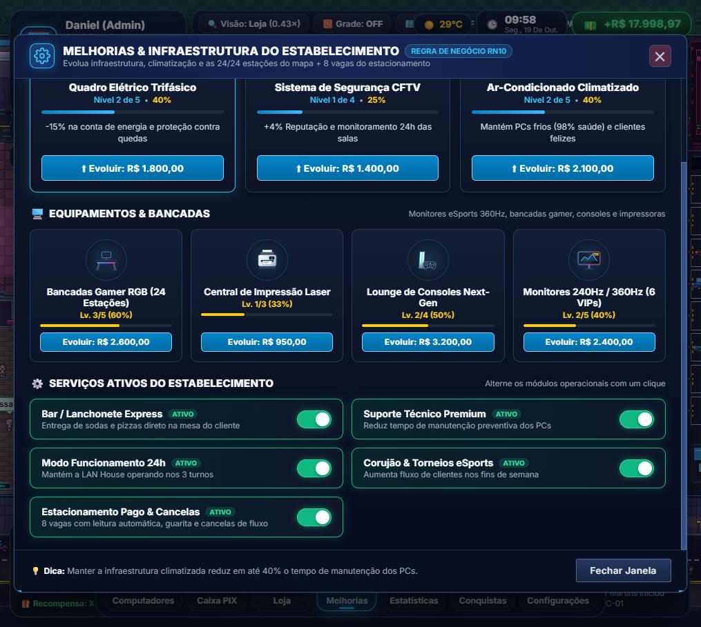 | Evolução por nível (`INFRAESTRUTURA`, `EQUIPAMENTOS`, `SERVICOS`) e toggle `srv_estacionamento` ativo. |
| **Estacionamento & Cancelas** | 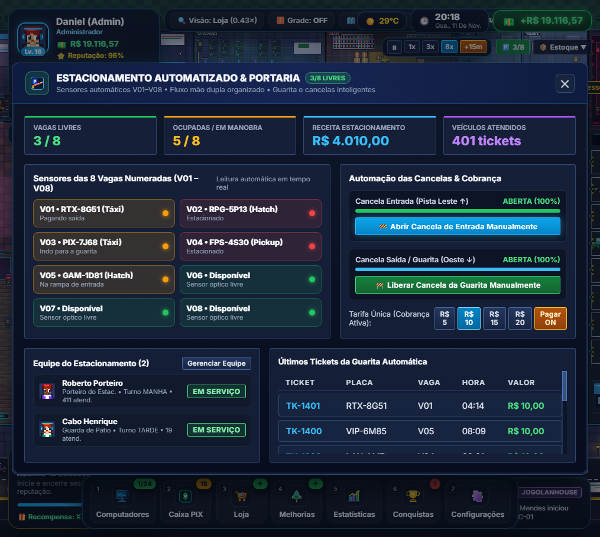 | Vagas `V01–V08` (`3/8` livres), cancelas `ABERTA (100%)`, `401 tickets` (`R$ 4.010,00`), ticket `TK-1401`. |
| **Equipe & Funcionários** | 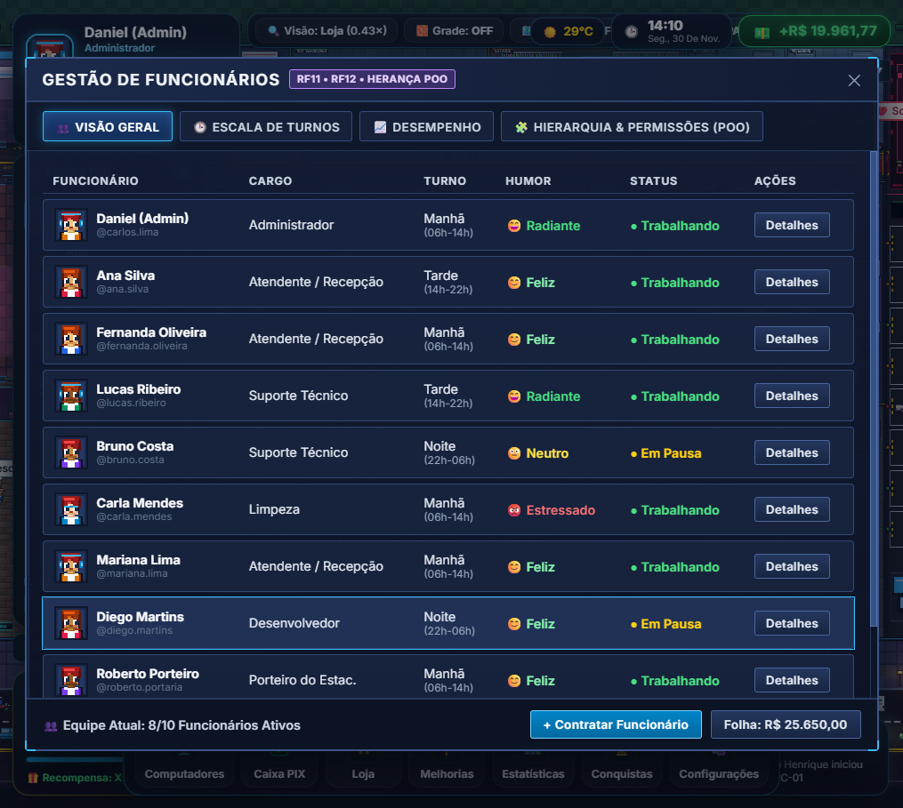 | `8/10 Funcionários Ativos` em turno (`Folha: R$ 25.650,00`), incluindo `Porteiro do Estac.` e `Guarda`. |
| **Hierarquia `PerfilCargoPOO`** | 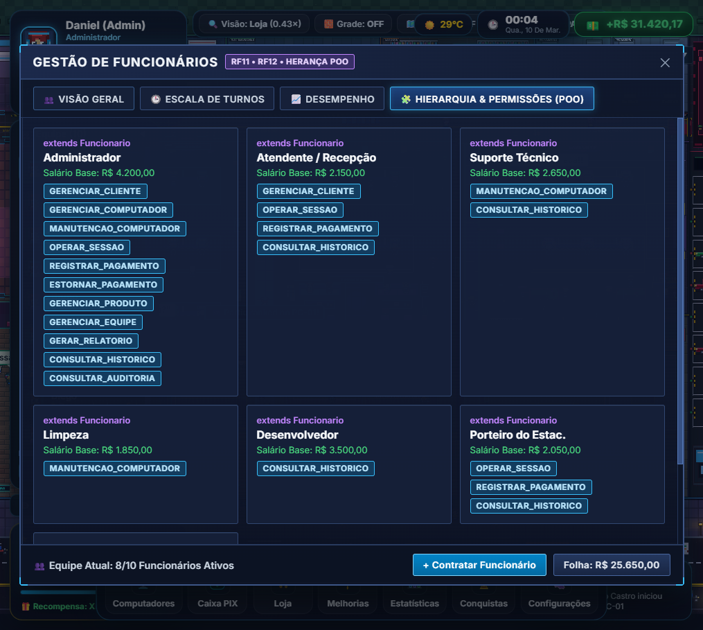 | Sub-aba renderizando na UI a herança `extends Funcionario` das 7 subclasses e suas permissões. |
| **Login & Controle RBAC** | 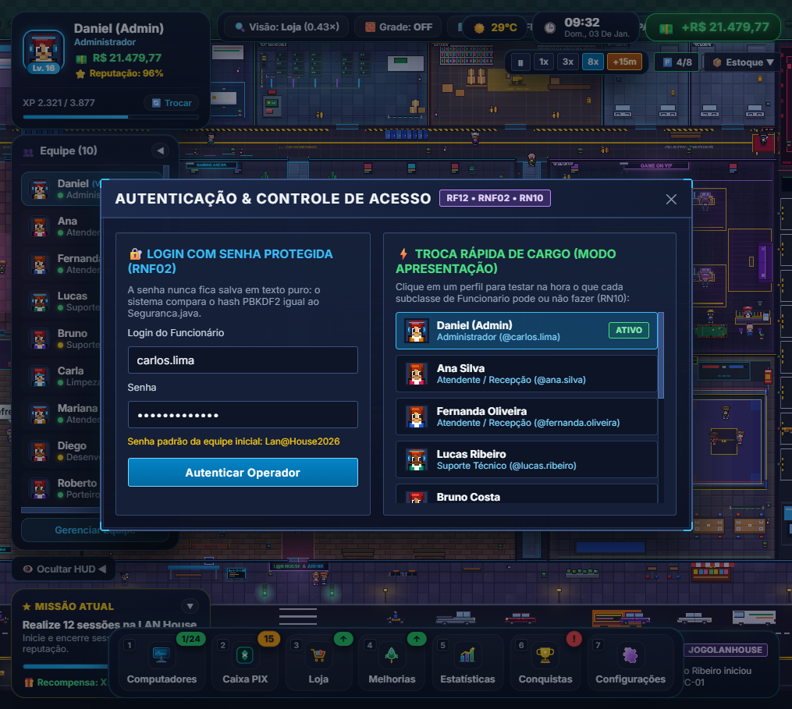 | Hash PBKDF2 (`RNF02`), barreira `exigirPermissao()` e **Troca Rápida de Cargo (`RN10`)** ao vivo. |
| **Estatísticas & Auditoria** | 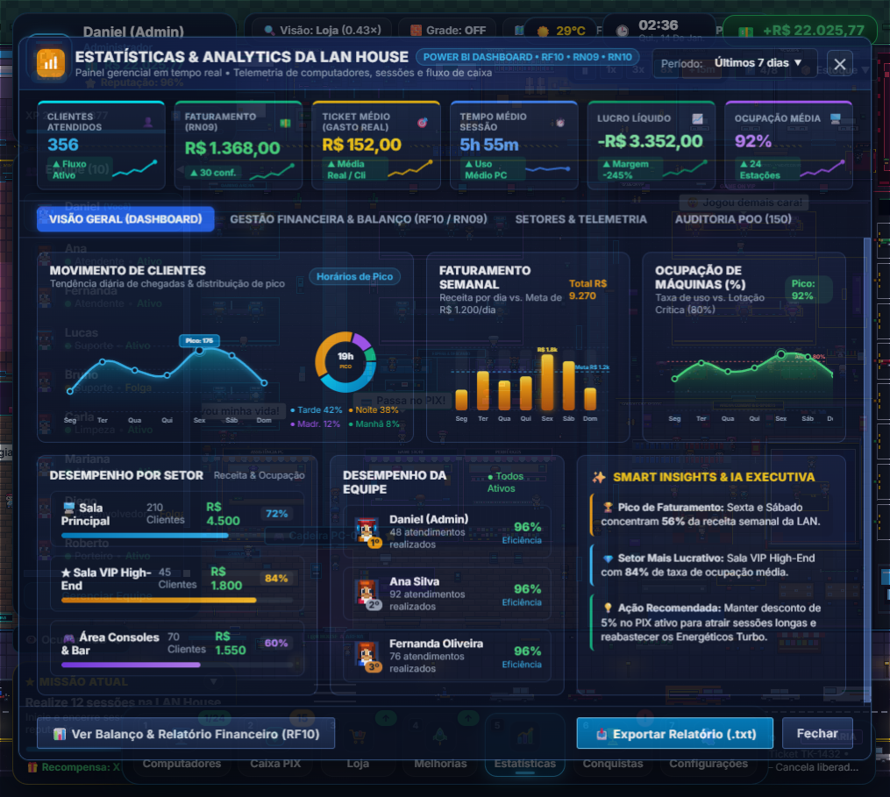 | Power BI em tempo real: `356` clientes, `92%` ocupação, ticket médio `R$ 152,00`, `5h 55m` e `RN09`. |
| **Conquistas (Observer)** | 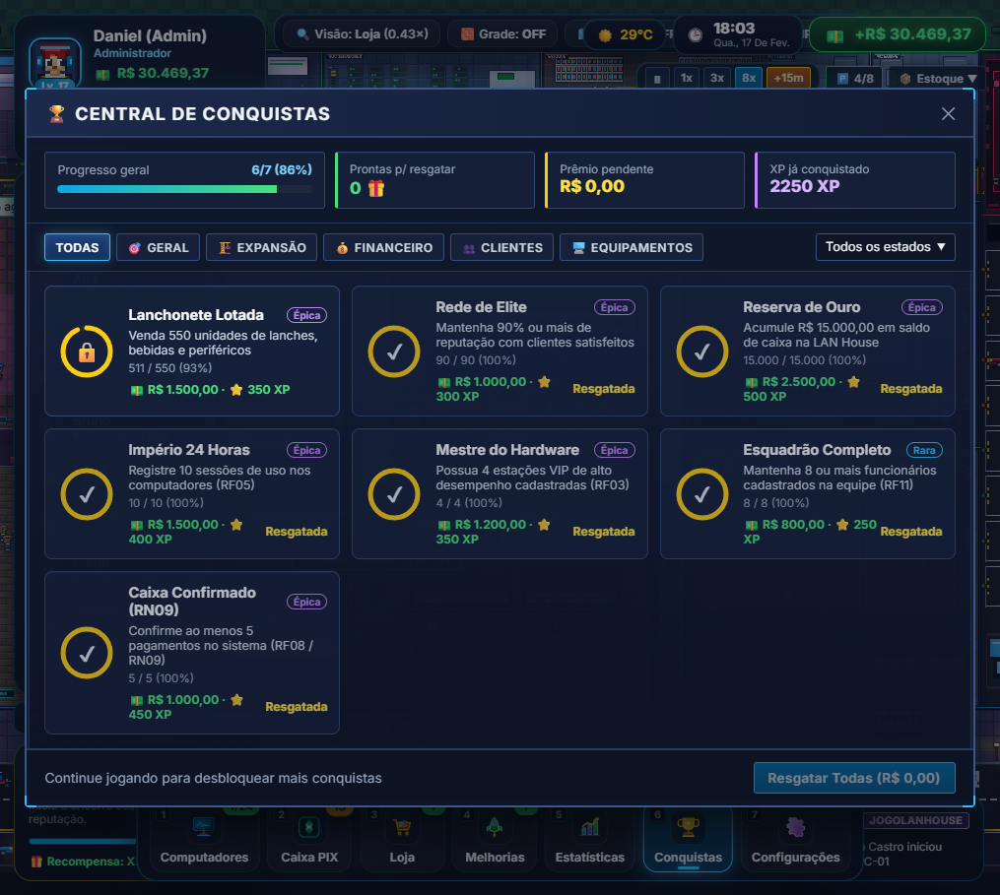 | `6/7 (86%)` metas concluídas, `2250 XP`, Lv. 17 e resgate de recompensas atualizando o caixa ao vivo. |
| **Configurações (`RNF06`)** | 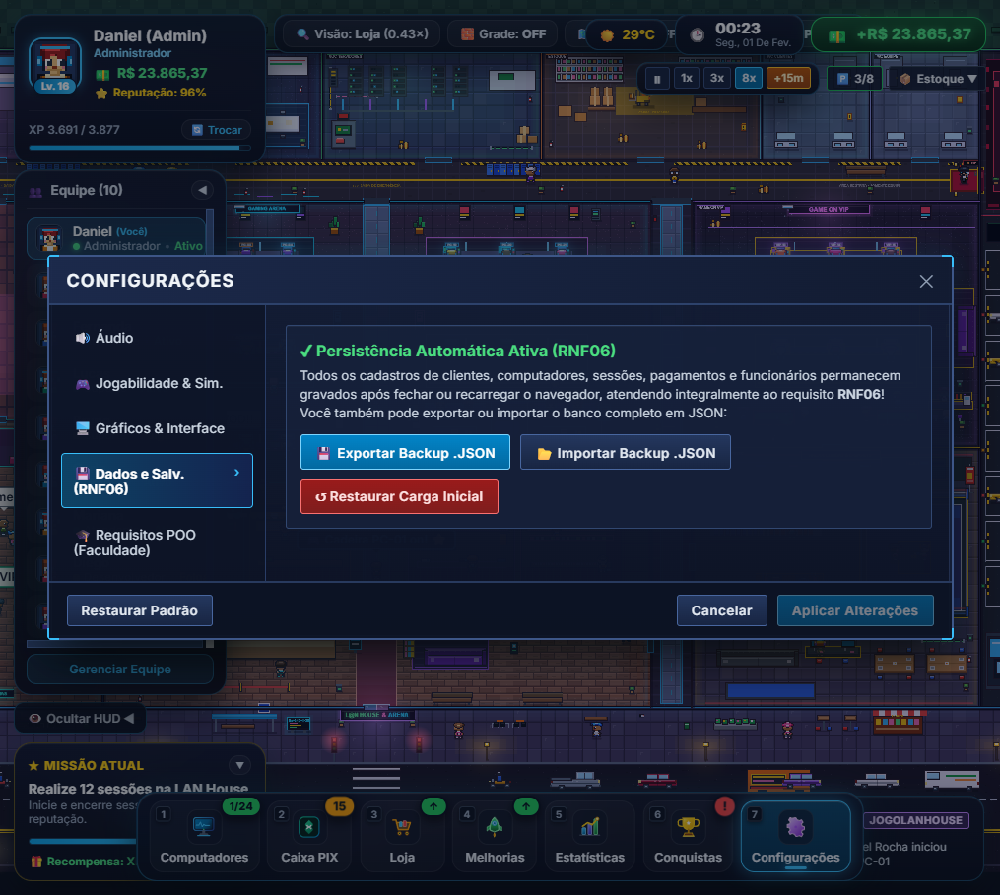 | Persistência automática no `localStorage`, exportação/importação `.JSON` e restauração inicial. |

</details>

---

## ⌨️ Atalhos de Teclado e Controles

| Tecla | Ação na Interface |
| :---: | :--- |
| **`1`** | Abrir / fechar **Computadores & Telemetria** |
| **`2`** | Abrir / fechar **Clientes & Caixa PIX** |
| **`3`** | Abrir / fechar **Loja & Bomboniere** |
| **`4`** | Abrir / fechar **Melhorias & Infraestrutura** |
| **`5`** | Abrir / fechar **Equipe & Hierarquia POO** |
| **`6`** | Abrir / fechar **Estatísticas & Auditoria (`RF10 / RN09`)** |
| **`7`** | Abrir / fechar **Conquistas** |
| **`8`** | Abrir / fechar **Configurações (`RNF06`)** |
| **`H`** | **Ocultar / Mostrar HUD** (modo mapa panorâmico limpo) |

---

## 🚀 Como Executar o Projeto

### Pré-requisitos
- **Node.js 18+** e **npm** instalados.

### Instalação e Execução Local

```bash
# 1. Clonar o repositório
git clone https://github.com/DanirlG7/lan-hbouse-.git
cd lan-hbouse-

# 2. Instalar dependências
npm install

# 3. Iniciar o servidor de desenvolvimento Vite (porta 5173)
npm run dev
```

Acesse **`http://localhost:5173`** no navegador.

### Scripts Disponíveis (`package.json`)

| Comando | Descrição |
| :--- | :--- |
| `npm run dev` | Sobe o servidor Vite em `http://localhost:5173` com Hot Module Replacement |
| `npm run build` | Executa checagem estrita TypeScript (`tsc -b`) + bundle de produção Vite (`dist/`) |
| `npm run preview` | Serve o build de produção localmente na porta `4173` (`vite preview --port 4173`) |

---

## ☕ Integração Opcional com Backend Java (`JDK 17`)

O adaptador [`java-bridge/ServidorHttpLanHouse.java`](./java-bridge/ServidorHttpLanHouse.java) utiliza exclusivamente o `com.sun.net.httpserver.HttpServer` nativo do **JDK 17** (zero dependências externas ou Maven), expondo a fachada `JogoLanHouse` na porta **`8080`**:

1. Copie `java-bridge/ServidorHttpLanHouse.java` para `lanhouse/src/lanhouse/web/ServidorHttpLanHouse.java` no projeto Java.
2. Compile com `compilar.bat` e execute:
   ```bash
   java -cp out lanhouse.web.ServidorHttpLanHouse
   ```
3. Endpoints expostos com suporte a CORS:
   - `GET /api/health` — Verifica status do motor `JogoLanHouse-JDK17` e relógio simulado.
   - `GET /api/avancar` — Avança a simulação Java e retorna o resumo (`passos`, `terminou`, `sessoes`, `atendidos`, `itensVendidos`).
   - `GET /api/eventos` — Lista os últimos 20 eventos registrados pelo motor.

---

## 📂 Estrutura do Repositório

```text
lanhouse-pixel-web/
├── docs/
│   ├── screenshots/                    # 13 capturas reais da simulação no navegador
│   ├── LanHouse_POO_Apresentacao.pptx  # Apresentação PowerPoint pronta (14 slides)
│   └── ROTEIRO_SLIDES_POO.md           # Roteiro completo, UML e resultados da simulação
├── java-bridge/
│   └── ServidorHttpLanHouse.java       # Adaptador HTTP JDK 17 opcional (porta 8080)
├── public/assets/                      # Assets estáticos de mapa
├── src/
│   ├── audio/
│   │   └── soundEffects.ts             # Efeitos sonoros sintetizados da interface
│   ├── domain/
│   │   ├── LanHouseEngine.ts           # Motor OO (PerfilCargoPOO, ProcessadorFormaPagamento, LanHouseStore)
│   │   ├── WaypointGraph.ts            # Navegação e rotas de NPCs pelos setores
│   │   └── types.ts                    # Interfaces, tipos, cargos, permissões e contratos
│   ├── world/
│   │   ├── constants.ts                # Escala 96x64 (3072x2048px) e grade de colisão
│   │   ├── layout.ts, collision.ts     # Arquitetura dos salões, PCs e colisões
│   │   ├── graph.ts                    # Grafo NoGrafo / construirGrafo()
│   │   ├── parking.ts                  # Estacionamento V01–V08, cancelas e FSM (9 fases)
│   │   ├── traffic.ts                  # Fluxo de veículos na avenida externa
│   │   └── decor.ts, detalhes.ts, mobiliario.ts
│   └── components/
│       ├── HudOverlay.tsx              # HUD principal, dock [1..8], atalho [H] e relógio
│       ├── LanHouseCanvas.tsx          # Loop principal do Canvas 2D
│       ├── *Renderer.ts / HdIcons.tsx  # Renderizadores de mapa, mobília, tráfego e ícones
│       └── modals/                     # 10 modais React reativos (Computadores, Caixa, Loja, etc.)
└── tools/
    └── auditar_grafo_vs_detalhes.ts    # Auditoria de consistência entre grafo e layout
```

---

## 🎓 Material de Apresentação

Todo o material de defesa e explicação arquitetural da disciplina está organizado na pasta [`docs/`](./docs):
- 📄 **Roteiro Completo + UML + Prints:** [`docs/ROTEIRO_SLIDES_POO.md`](./docs/ROTEIRO_SLIDES_POO.md)
- 📊 **Slides em PowerPoint (14 slides com prints reais):** [`docs/LanHouse_POO_Apresentacao.pptx`](./docs/LanHouse_POO_Apresentacao.pptx)

---

## 👤 Autor

**Daniel Ramos** (`@DanirlG7`) — Ciência da Computação (Universidade de Cuiabá — UNIC)
- GitHub: [github.com/DanirlG7](https://github.com/DanirlG7)
