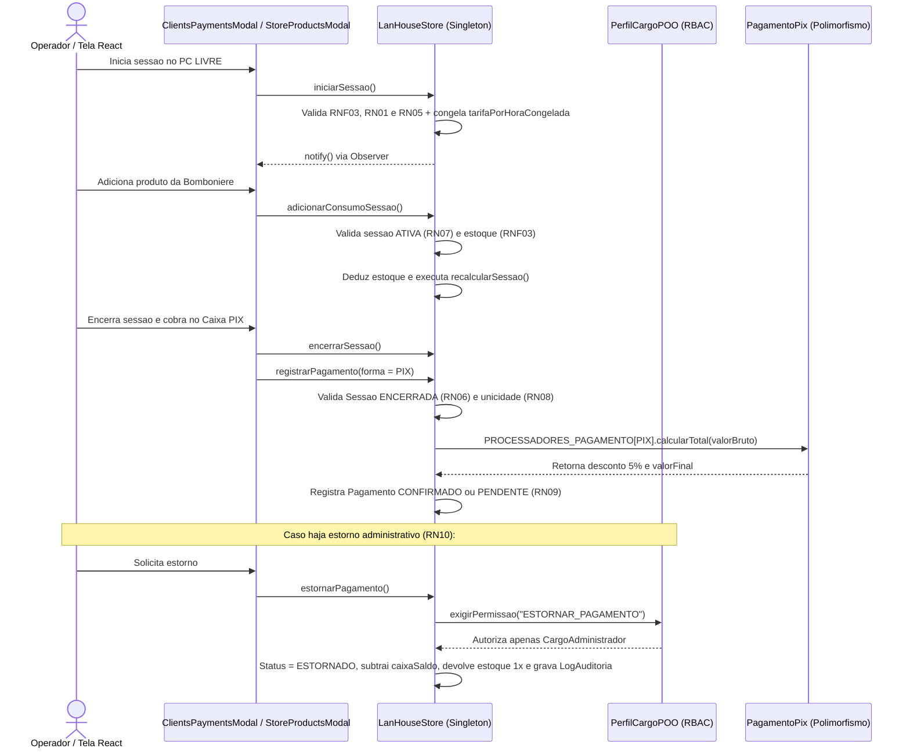
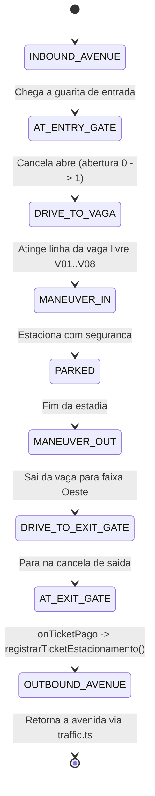

# Roteiro de Apresentação e Arquitetura POO — LAN House & Arena Pixel Art (14 Slides + Simulação)

Este documento reúne o **roteiro completo dos 14 slides**, os **resultados reais observados na simulação ao vivo no navegador**, os **links para todas as capturas de tela em `./screenshots/`** e os **diagramas UML formais** (`classDiagram`, `sequenceDiagram` e `stateDiagram-v2`) baseados diretamente no código-fonte de `src/domain/LanHouseEngine.ts`, `src/domain/types.ts`, `src/world/parking.ts`, `src/world/graph.ts`, `src/components/HudOverlay.tsx` e `src/components/modals/*`.

---

## Links dos Entregáveis Gerados

- **Google Slides (Apresentação na conta Google — 14 slides com prints reais):** [Abrir no Google Slides](https://docs.google.com/presentation/d/1lPnFuC5ynhSeuHAZXMHh1xO8c-KtMI3HyNbStOSVE1Q/edit)
- **PowerPoint Local (`.pptx` exportado, 5,83 MB):** [LanHouse_POO_Apresentacao.pptx](./LanHouse_POO_Apresentacao.pptx)
- **FigJam (3 Diagramas Editáveis: Arquitetura, Estados e Modelo ER):** [Abrir Board no FigJam](https://www.figma.com/board/U8vFPc8Bv3riqwlTsk3Vwu)
- **Figma Design — Deck Interativo v2 (14 slides com prints e zoom lightbox, Code Layer `3:3`):** [Abrir Deck v2 no Figma](https://www.figma.com/design/XYzkHtNAvqKmwQP8FxKpiR?node-id=3-3&autoplay-code-preview=3-3&code-import-attempt-id=6b19b6a9e5e249b159bbd167f393dce90b567909c1886f3121c6b6b6d6ac4466&code-import-node-id=3-3&code-import-surface=code_layer)
- **Figma Design — Deck Interativo v1 (10 slides originais, Code Layer `1:3`):** [Abrir Deck v1 no Figma](https://www.figma.com/design/XYzkHtNAvqKmwQP8FxKpiR?node-id=1-3&autoplay-code-preview=1-3&code-import-attempt-id=dbe6741815dcfa31ced34202ccc39a60458978c98c39cc30b8eb13e2faf804da&code-import-node-id=1-3&code-import-surface=code_layer)
- **Capturas de Tela da Simulação:** [screenshots/](./screenshots)

---

## Balanço Real da Simulação Executada

- **Caixa evoluindo ao vivo:** `R$ 14.064,57` → **`R$ 31.420,17`** (após simulação `8x`, avanço `+15m`, bomboniere, checkout PIX, estacionamento e resgate de conquistas `+R$ 5.800`).
- **Máquinas (`RF03–RF07`, `RN01`, `RN05`):** **`24/24`** estações (`18 comuns + 6 VIP`), `22 em uso (92%)`, `1 livre`, `PC-03` em manutenção, receita de `R$ 286,00/h`, Sessão `#236 — Gabriel Rocha` (CPU `68°C`, `340W`).
- **Checkout Polimórfico PIX:** `R$ 48,00` (`6h @ R$ 8,00/h` no `PC-01`) com **`-R$ 2,40` (5% OFF)** via `PagamentoPix`, totalizando **`R$ 45,60`** (`#647 / S#267 CONFIRMADO`).
- **Estacionamento Automatizado:** cancelas em `ABERTA (100%)` após pulso manual, vagas `V01–V08` (`3/8` livres), **`401 tickets`**, **`R$ 4.010,00`**, último registro `TK-1401` (`RTX-8G51 V01 R$ 10,00`), `Roberto Porteiro` & `Cabo Henrique` em serviço.
- **Analytics (`RN09`), Equipe (`RF11`) & Conquistas:** `356` clientes atendidos, ticket médio `R$ 152,00`, tempo médio `5h 55m`, `8/10` funcionários ativos em turno (`Folha: R$ 25.650,00`) e `6/7 (86%)` metas resgatadas (`2250 XP`, Lv. 17).

---

## 1. Diagrama UML de Classes — Motor de Domínio (`LanHouseEngine.ts` & `types.ts`)

```mermaid
classDiagram
    class PerfilCargoPOO {
        <<abstract>>
        +readonly cargo
        +readonly nomeExibicao
        +readonly salarioBase
        +obterPermissoes()* Permissao[]
        +possuiPermissao(p) boolean
    }

    class CargoAdministrador { +obterPermissoes() Permissao[] }
    class CargoDesenvolvedor { +obterPermissoes() Permissao[] }
    class CargoSuporteTecnico { +obterPermissoes() Permissao[] }
    class CargoRecepcionista { +obterPermissoes() Permissao[] }
    class CargoLimpeza { +obterPermissoes() Permissao[] }
    class CargoPorteiroEstacionamento { +obterPermissoes() Permissao[] }
    class CargoGuardaPatio { +obterPermissoes() Permissao[] }

    PerfilCargoPOO <|-- CargoAdministrador
    PerfilCargoPOO <|-- CargoDesenvolvedor
    PerfilCargoPOO <|-- CargoSuporteTecnico
    PerfilCargoPOO <|-- CargoRecepcionista
    PerfilCargoPOO <|-- CargoLimpeza
    PerfilCargoPOO <|-- CargoPorteiroEstacionamento
    PerfilCargoPOO <|-- CargoGuardaPatio

    class ProcessadorFormaPagamento {
        <<abstract>>
        +calcularTotal(valorBruto)*
    }
    class PagamentoPix { +calcularTotal(valorBruto) }
    class PagamentoDinheiro { +calcularTotal(valorBruto) }
    class PagamentoCartaoDebito { +calcularTotal(valorBruto) }
    class PagamentoCartaoCredito { +calcularTotal(valorBruto) }

    ProcessadorFormaPagamento <|-- PagamentoPix
    ProcessadorFormaPagamento <|-- PagamentoDinheiro
    ProcessadorFormaPagamento <|-- PagamentoCartaoDebito
    ProcessadorFormaPagamento <|-- PagamentoCartaoCredito

    class LanHouseStore {
        -state: EstadoCompletoLanHouse
        -listeners: Set
        +readonly MAX_ESTACOES_MAPA = 24
        +subscribe(listener)
        -salvarEEmitir()
        -exigirPermissao(permissao)
        -registrarLog(categoria, acao)
        +autenticar(login, senha)
        +contratarFuncionario()
        +cadastrarComputador()
        +iniciarSessao()
        +adicionarConsumoSessao()
        -recalcularSessao(sessao)
        +encerrarSessao()
        +registrarPagamento()
        +confirmarPagamentoPendente()
        +estornarPagamento()
        +reporEstoqueProduto()
        +evoluirMelhoriaEstabelecimento()
        +registrarTicketEstacionamento()
        +alterarTarifaEstacionamento()
        +gerarRelatorioFinanceiro()
        +obterConquistas()
    }

    LanHouseStore ..> PerfilCargoPOO : consulta FABRICA_CARGOS
    LanHouseStore ..> ProcessadorFormaPagamento : consulta PROCESSADORES_PAGAMENTO
    LanHouseStore *-- "1..24" Computador : gerencia
    LanHouseStore *-- "*" Sessao : registra
    LanHouseStore *-- "*" Pagamento : liquida
    LanHouseStore *-- "*" Produto : estoca
    LanHouseStore *-- "*" Funcionario : emprega
    LanHouseStore *-- "*" LogAuditoria : audita
    Sessao *-- "*" ItemConsumacao : compoe
    ItemConsumacao --> Produto : referencia
```

---

## 2. Fluxo Polimórfico de Sessão, Consumo, PIX e Estorno (`sequenceDiagram`)

---

## 3. Máquina de Estados Finitos do Estacionamento (`src/world/parking.ts`)

---

## 4. Mapeamento Completo Tela / Modal × Conceito POO

| Tela / Modal (`src/components/modals/*` & HUD) | Classes / Entidades Principais | Conceito POO Predominante | Regras de Negócio & Evidência no Jogo | Captura Real |
| :--- | :--- | :--- | :--- | :--- |
| **HUD Principal & Retrátil `[H]`** (`HudOverlay.tsx`) | `LanHouseStore`, `NoGrafo`, `construirGrafo()` | **Observer (`subscribe`)** | Avanço `8x` e `+15m (RF07 / RN04)`, caixa inicial `R$ 14.064,57` e mapa `96x64` livre | [01](./screenshots/01_hud_simulacao_8x.png) / [02](./screenshots/02_mapa_sem_hud.png) |
| **Funcionários** (`EmployeesModal.tsx`) | `Funcionario`, `PerfilCargoPOO`, `FABRICA_CARGOS` | **Abstração + Herança + Factory** | `RF11`; `8/10 Ativos`, folha `R$ 25.650,00` e aba `Hierarquia POO` (`extends Funcionario`) | [08](./screenshots/08_equipe_funcionarios.png) / [13](./screenshots/13_hierarquia_cargos_poo.png) |
| **Login Operador** (`LoginOperatorModal.tsx`) | `Funcionario`, `gerarHashSenha()`, `RegraNegocioError` | **RBAC + Encapsulamento** | `RF12`, `RN10`, `RNF02` (PBKDF2), Troca Rápida de Cargo e `exigirPermissao()` | [09](./screenshots/09_login_operador_rnf02.png) |
| **Clientes / Caixa PIX** (`ClientsPaymentsModal.tsx`) | `Cliente`, `Pagamento`, `ProcessadorFormaPagamento`, `PagamentoPix` | **Polimorfismo** (`calcularTotal`) | `RF01`, `RF08`, `RN06`, `RN08`, `RN09`; PIX `-R$ 2,40` (`R$ 45,60` `#647 CONFIRMADO`) | [05](./screenshots/05_clientes_caixa_pix.png) |
| **Computadores** (`ComputersSessionsModal.tsx`) | `Computador`, `Sessao` (18 comuns + 6 VIP) | **Encapsulamento + Estados** | `RF03–RF07`, `RN01`, `RN05`, `MAX_ESTACOES_MAPA = 24`, `22 em uso (92%)`, `PC-03` manutenção | [03](./screenshots/03_computadores_sessoes.png) |
| **Loja / Bomboniere** (`StoreProductsModal.tsx`) | `Produto`, `ItemConsumacao`, `Sessao` | **Composição de Objetos** | `RN07`, `RNF03`; estoque `R$ 2.728,00`, `7 produtos`, entrega no `PC-01` e `estoqueDevolvido` | [04](./screenshots/04_loja_bomboniere.png) |
| **Melhorias** (`UpgradesEstablishmentModal.tsx`) | `MelhoriaEstabelecimento` | **Controle de Estado & Saldo** | Evolução até `nivelMax` e toggle `srv_estacionamento` (`Estacionamento Pago ATIVO`) | [06](./screenshots/06_melhorias_infra.png) |
| **Estacionamento** (`ParkingAutomationModal.tsx`) | `VagaEstacionamento`, `VeiculoEstacionamento`, `EstadoCancela`, `EventoTicketEstacionamento`, `RegistroTicketEstacionamento` | **Máquina de Estados Finitos** | 9 fases (`FaseCarroEstac`), cancelas `ABERTA (100%)`, `401 tickets` (`R$ 4.010,00`), `TK-1401` | [07](./screenshots/07_estacionamento_cancelas.png) |
| **Estatísticas** (`StatisticsReportModal.tsx`) | `RelatorioFinanceiro`, `LogAuditoria`, `LinhaHoraria` | **Agregação & Imutabilidade** | `RF10`, `RN09` (`356` clientes, `92%` ocupação, `R$ 152,00` ticket, `5h 55m`, 150 logs) | [10](./screenshots/10_estatisticas_rn09.png) |
| **Conquistas / Config** (`AchievementsModal.tsx`, `SettingsModal.tsx`) | `Conquista`, `ConfiguracoesJogo`, `LanHouseStore` | **Observer + Persistência (`RNF06`)** | `6/7` conquistas (`+R$ 5.800`, `2250 XP`, Lv. 17) e Exportar/Importar `.JSON` (`salvarEEmitir()`) | [12](./screenshots/12_conquistas_resgate.png) / [11](./screenshots/11_configuracoes_rnf06.png) |

---

## 5. Roteiro de Fala — Slide a Slide (14 Slides)

### Slide 01 — Capa (`01_hud_simulacao_8x.png`)
- **Objetivo:** Mostrar o jogo rodando ao vivo em `8x` e `+15m (RF07 / RN04)` e introduzir os 4 pilares da POO que sustentam o projeto.

### Slide 02 — Visão Panorâmica `[H]` & Fundamentos POO (`02_mapa_sem_hud.png`)
- **Objetivo:** Demonstrar o modo mapa limpo `[H]` (`96x64`) e situar Abstração, Encapsulamento, Herança e Polimorfismo dentro de `LanHouseEngine.ts`.

### Slide 03 — Aba Equipe & Cargos (`08_equipe_funcionarios.png`)
- **Objetivo:** Explicar `FABRICA_CARGOS[cargo]` em `contratarFuncionario()` e mostrar `8/10 Funcionários Ativos` com folha de `R$ 25.650,00`.

### Slide 04 — Hierarquia `PerfilCargoPOO` em Tempo Real (`13_hierarquia_cargos_poo.png`)
- **Objetivo:** Exibir a sub-aba `HIERARQUIA & PERMISSÕES (POO)` renderizando a herança real (`extends Funcionario`) das 7 subclasses diretamente na interface do jogo.

### Slide 05 — Login & Controle de Acesso (`09_login_operador_rnf02.png`)
- **Objetivo:** Detalhar `gerarHashSenha()` (`RNF02`), Troca Rápida (`RN10`) e `exigirPermissao()` gravando `LogAuditoria` e lançando `RegraNegocioError`.

### Slide 06 — Clientes & Caixa PIX (`05_clientes_caixa_pix.png`)
- **Objetivo:** Demonstrar `PagamentoPix.calcularTotal()` aplicando `5% OFF` (`R$ 48,00 -> R$ 45,60` no pedido `#647 CONFIRMADO`) e explicar `RN06`, `RN08`, `RN09` e `RN10`.

### Slide 07 — Computadores & Sessões (`03_computadores_sessoes.png`)
- **Objetivo:** Mostrar paridade `24/24` (`MAX_ESTACOES_MAPA = 24`), `22 em uso (92%)`, `PC-03` em manutenção, `R$ 286,00/h`, `tarifaPorHoraCongelada` e Sessão `#236`.

### Slide 08 — Loja & Bomboniere (`04_loja_bomboniere.png`)
- **Objetivo:** Explicar a composição `Sessao *-- ItemConsumacao --> Produto`, bloqueio `RN07`/`RNF03`, estoque de `R$ 2.728,00` entregando no `PC-01` e devolução idempotente (`estoqueDevolvido`).

### Slide 09 — Melhorias & Infraestrutura (`06_melhorias_infra.png`)
- **Objetivo:** Mostrar evolução de níveis em `MelhoriaEstabelecimento` e o toggle `srv_estacionamento` conectando melhorias à portaria.

### Slide 10 — Estacionamento Automatizado (`07_estacionamento_cancelas.png`)
- **Objetivo:** Apresentar a máquina de estados de 9 fases (`src/world/parking.ts`), anti-colisão, cancelas em `ABERTA (100%)` após acionamento manual e `onTicketPago` (`401 tickets`, `R$ 4.010,00`, `TK-1401`).

### Slide 11 — Estatísticas & Auditoria (`10_estatisticas_rn09.png`)
- **Objetivo:** Mostrar `gerarRelatorioFinanceiro()` filtrando apenas pagamentos `CONFIRMADO` (`RN09`), além de `356` clientes, `92%` ocupação, ticket `R$ 152,00` e `5h 55m`.

### Slide 12 — Conquistas & Configurações (`12_conquistas_resgate.png` + `11_configuracoes_rnf06.png`)
- **Objetivo:** Demonstrar resgate de `+R$ 5.800` (`6/7` metas, `2250 XP`, Lv. 17) propagado pelo Observer `subscribe()` + persistência `.JSON` (`RNF06`) em `salvarEEmitir()`.

### Slide 13 — Tabela Síntese Tela × Classe × Conceito POO × Evidência
- **Objetivo:** Consulta rápida relacionando todas as telas às suas classes, conceitos e números capturados.

### Slide 14 — Síntese Arquitetural em 3 Camadas + Balanço Final
- **Objetivo:** Fechar consolidando **Camada 1 (Domínio POO)**, **Camada 2 (Simulação, `parking.ts`, `traffic.ts`, `graph.ts` com `NoGrafo`/`construirGrafo()`)** e **Camada 3 (React & Canvas)** com o balanço final `R$ 14.064,57 -> R$ 31.420,17`.
